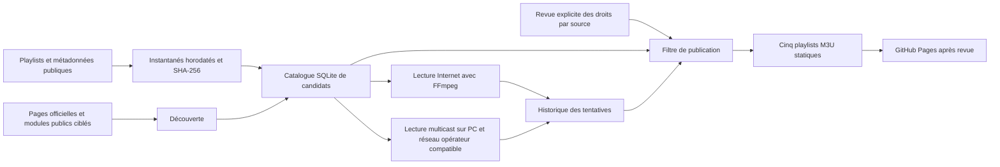

# Architecture du prototype avant mise en ligne — 15 novembre 2026

> Document historique : pour le système désormais destiné à GitHub et sa planification, voir [publication-github.md](publication-github.md).

Un programme Python en ligne de commande possède la base SQLite. FFmpeg est un processus enfant limité dans le temps ; aucun serveur n'est nécessaire en exploitation. Le petit serveur HTTP des tests écoute uniquement sur la boucle locale et s'arrête après le test.

## Responsabilités

| Élément | Fonction |
|---|---|
| `tools/acquire.py` | Récupérer les entrées d'audit ; figer les fichiers GitHub sur une révision ; conserver taille, date et empreinte |
| `catalog.py` | Parser les collections M3U, rapprocher les identifiants, conserver les origines et exporter le catalogue |
| `discover.py` | Examiner les pages officielles, modules ciblés et lecteurs intégrés autorisés, sans exécuter leur JavaScript |
| `verify.py` | Contrôler les manifestes et décoder vidéo et audio ; conserver les tentatives et leur contexte |
| `publish.py` | Appliquer une revue explicite, sélectionner les sources éligibles et produire playlists/rapports |
| `cli.py` | Commandes utilisables sous Windows, Linux et Raspberry Pi OS |

Le catalogue distingue l'identité de la chaîne, l'URL du flux et l'origine de découverte. Un même flux peut avoir plusieurs origines. Son identifiant est une empreinte déterministe de la chaîne et de l'URL exacte. Les paramètres d'URL ne sont pas supprimés pour « réparer » les liens. Les anciennes variantes non reconnues restent des candidats `local.*` plutôt que de fusionner arbitrairement deux chaînes.

Le suivi demandé ajoute un profil de classement Suisse romande dans YAML, la préférence des variantes CH par emplacement et des numéros `tvg-chno`. Les identités alternatives restent dans le catalogue. Le PC Sunrise est le poste de validation courant ; Kodi sur Raspberry Pi est le lecteur cible, sans exécution de tests demandée sur ce dernier.

## Modèle SQLite

| Table | Données et garanties |
|---|---|
| `channels` | Identifiant, nom, pays, langue française recherchée, catégories, logo, EPG, site et caractère régional |
| `sources` | URL exacte, priorité, protocole, restrictions déclarées, opérateur, première/dernière observation, état actif |
| `origins` | URL de découverte, empreinte du document, date d'observation ; unicité source/origine/version |
| `checks` | Historique append-only : exécution, tentative, date, pays/réseau, résultat, empreintes de manifestes, images décodées, codecs et dimensions |
| `reviews` | Décision explicite par URL, preuve et SHA-256, responsable, date, périmètre et conditions d'accès |
| `epg_checks` / `epg_channels` | Historique des contrôles XMLTV, empreintes, identifiants et couverture future, sans titres d'émissions |

Les exports JSON calculent les derniers résultats, dates et paramètres techniques à partir de l'historique. Le statut d'une lecture ne devient pas une décision de droits. Le champ `official` signifie qu'un lien a été retrouvé dans un document du diffuseur ou dans une ressource publique reliée ; il ne certifie pas une autorisation de redistribution. Les liens de distributeurs tels que net+ gardent leur provenance distincte et ne sont pas présentés comme des directs du diffuseur. Les logos restent des URL et sont inclus dans le périmètre de la revue avant publication.

## Vérification

HLS : distinguer liste maîtresse et liste de médias, résoudre les URI relatives, préférer une variante vidéo avant de minimiser le débit et vérifier ses segments par décodage. Une variante uniquement audio peut être la moins coûteuse d’un manifeste de télévision ; la choisir systématiquement était la cause d’un faux échec sur RTS 2. Les métadonnées RESOLUTION, VIDEO et CODECS servent à reconnaître la vidéo. DASH : parser le MPD, refuser `ContentProtection` et XLink, puis confier la résolution des segments à FFmpeg. Les manifestes chiffrés, y compris HLS AES-128, sont laissés de côté ; aucune clé n'est demandée. Les flux HTTP sans manifeste identifiable restent `unsupported_protocol` dans ce prototype.

Le succès exige un code de retour nul, plusieurs images décodées et une durée proche des cinq secondes demandées. Les dimensions proviennent du flux lu, jamais du nom de la chaîne. L'audio est décodé et son résultat enregistré. Pour un groupe HLS séparé, la langue française est préférée, puis la piste par défaut ; le manifeste audio est vérifié avant le décodage conjoint. La lecture vérifie un échantillon ; elle ne valide pas tous les programmes, variantes, codecs possibles ou droits variables selon l'heure.

Les paramètres YAML limitent les requêtes de manifeste, les tailles lues, les délais, le nombre de tentatives et la durée du processus. Les flux sont testés séquentiellement. FFmpeg peut effectuer plusieurs téléchargements de segments pendant l'échantillon : ce n'est pas un débit maximal strict par domaine. Une limitation globale par domaine et le respect de `Retry-After` seront nécessaires avant d'élargir la cadence ; un 429 arrête déjà la source.

Un HTTP 403 reste un refus de cause inconnue. Un timeout reste indéterminé. `unavailable` est réservé aux 404/410 répétés du même contexte. Un blocage légal HTTP 451 est distinct. Le multicast exige un réseau opérateur déclaré correspondant à la source ; la portée multicast est contrôlée, puis le socket est ouvert seulement dans ce contexte. Aucune conclusion sur un multicast n'est tirée d'un runner Internet.

## Publication

Une source doit cumuler une provenance enregistrée, une revue positive récente pour le bon périmètre, l'accès CH approuvé, une lecture récente depuis CH sur le réseau approprié et des preuves de décodage. Pour HTTP, le domaine d’un distributeur n’établit pas à lui seul une restriction réseau. Une revue explicite peut classer une URL stable en accès Internet, sous réserve d’une lecture CH avec un autre FAI identifié dans la preuve. Cette exception n’existe pas pour le multicast, qui garde la correspondance stricte d’opérateur. L'import, la découverte et la vérification ne créent aucune revue positive. Un nouveau lien change d'identifiant et requiert sa propre revue.

Les sources éligibles sont classées par priorité, puis une source par chaîne est choisie pour chaque sélection. Une variante Internet peut donc servir la sélection Internet et une variante multicast la sélection opérateur de la même chaîne. La sélection complète choisit la première source éligible. Les métadonnées `tvg-id`, nom, logo, groupe, langue et pays sont écrites en UTF-8 ; chaque fichier est remplacé atomiquement. Aucun flux vidéo n'est hébergé.

Les identifiants EPG d'origine sont conservés par source, avec l'identifiant de chaîne en repli. Les correspondances historiques ne garantissent pas la compatibilité avec n'importe quel fournisseur XMLTV. `epg-check` contrôle temporairement un XMLTV ou XMLTV gzip, sous limites de taille et de durée, et stocke les identifiants ainsi que la couverture future. Aucun programme n'est republié. Un seul guide récent et admis pour le périmètre est sélectionné par playlist ; `url-tvg`, `x-tvg-url` et les correspondances `tvg-id` sont générés après vérification. La CLI destine les exports domestiques à `output/domestic` et refuse leur écriture sous `output/public`.

## Automatisation à généraliser après cette revue

La première phase contient un lanceur local `tools/update.py`, des commandes CLI et trois workflows préparés : tests Windows/Linux, audit Internet manuel et publication Pages manuelle du seul dossier public. Aucun cron n'est activé et aucun dépôt distant n'a été créé.

Pour la suite : import quotidien des seuls documents nécessaires avec cache HTTP/ETag ; comparaison aux instantanés précédents et mise en attente des liens nouveaux/modifiés/disparus ; vérification périodique des liens approuvés ; rapport des changements ; export après validation. Les échecs gardent leur historique et ne provoquent pas de suppression définitive à la première tentative. Il reste à implémenter le retrait des sources absentes de toutes les entrées récentes, le cache réseau et une file éditoriale de revue.

Sur le PC Sunrise, `Mettre_a_jour.cmd` lance la mise à jour à la demande : contrôle du pays CH, base SQLite persistante, verrou exclusif, découverte des pages, lecture des URL approuvées, contrôle EPG puis exports. Une sortie de connexion étrangère arrête la mise à jour avant le catalogue et libère le verrou. Les décisions restent liées à leur URL exacte et leur date n’est pas renouvelée automatiquement. La planification Windows quotidienne reste à activer ; les tests multicast restent des commandes distinctes sur réseau compatible. Le Raspberry Pi sert de lecteur Kodi. Sur GitHub : ne contrôler que les flux Internet ; son résultat garde le pays réel du runner. La transmission vers GitHub de preuves du PC devra être authentifiée et liée à l'URL exacte avant toute automatisation de publication. Aucun endpoint local public n'est nécessaire.

Les workflows actuels ne synchronisent pas les bases entre machines et le workflow Pages ne régénère pas les liens : régénérer et revoir localement les exports avant chaque déploiement. La protection d'environnement GitHub peut ajouter une dernière revue humaine au déploiement, sans remplacer le filtre du générateur.

## Limites et décisions de phase

La sélection domestique étendue de 54 chaînes et le guide de 45 chaînes sont disponibles ; les preuves détaillées figurent dans le rapport courant. Le chargement dans Kodi sur le Raspberry Pi reste à constater par l’utilisateur. Les tests média sont réalisés sur le PC Sunrise, comme demandé. Les essais multicast RTS 1/2 n’ont reçu aucun flux. Il reste à étendre les adaptateurs officiels, confirmer l’identité visuelle et la continuité de tous les programmes, obtenir des séries de résultats dans le temps et développer une collecte EPG autonome. Le guide actuel provient d’EPGSHARE01 et n’est pas réhébergé. Les en-têtes spéciaux des playlists tierces ne sont pas exécutés : pas de récupération de cookies, de jetons ni de contournement. Le code Python est portable ; seul Windows a été exécuté ici, Linux est couvert par la configuration CI à lancer dans le futur dépôt.

Le lanceur n'importe pas quotidiennement toute la base communautaire : il revisite les pages officielles configurées et laisse toute nouvelle URL en attente. Les adaptateurs utilisent uniquement des configurations publiques reliées aux pages officielles : SRG (filtrage explicite DRM/jetons), Carac (API de chaîne), Infomaniak (intégrations constantes) et ARTE (erreurs d'accès explicites). Un refus géographique observé à l'étranger ne devient pas un refus suisse. La sélection privée est aussi empaquetée dans un ZIP pour Kodi ; le paquet contient les cinq M3U et les instructions, sans médias ou programmes XMLTV.

## Extension net+ du 15 novembre 2026

La sélection comprend 37 chaînes supplémentaires provenant d’URL d’entrée publiques de net+ déjà présentes dans les listes examinées. Elles ont été relues sur Sunrise sans compte, achat ou copie de jeton. Les redirections normales du serveur émettent parfois une session CDN liée à la connexion : le vérificateur la suit pendant le contrôle, puis masque son chemin dans les rapports. Le M3U conserve toujours l’URL d’entrée stable, afin que chaque lecteur obtienne sa propre redirection. Aucun jeton ni clé n’est fabriqué ou modifié.

Les décisions domestiques exactes sont conservées dans le fichier local de revues. Le contrôle des droits tient compte du cadre IPI de lecture privée et des CG net+ archivées ; il ne prétend pas attribuer un abonnement ou une permission générale de publication du distributeur. L’offre commerciale TV Mobile n’est pas présentée comme gratuite. Les bouquets premium restent exclus. Le rafraîchissement de ces URL est direct : il ne dépend pas d’une modification quotidienne des listes GitHub.

Les variantes publicitaires suisses sont rapprochées par distributeur, sans remplacer les identités françaises des autres sources. Les noms affichés et les numéros sont configurés dans YAML. Le nouveau cas audio seul est vérifié par une fixture HLS avec véritable décodage, en plus des essais de diffuseurs.
